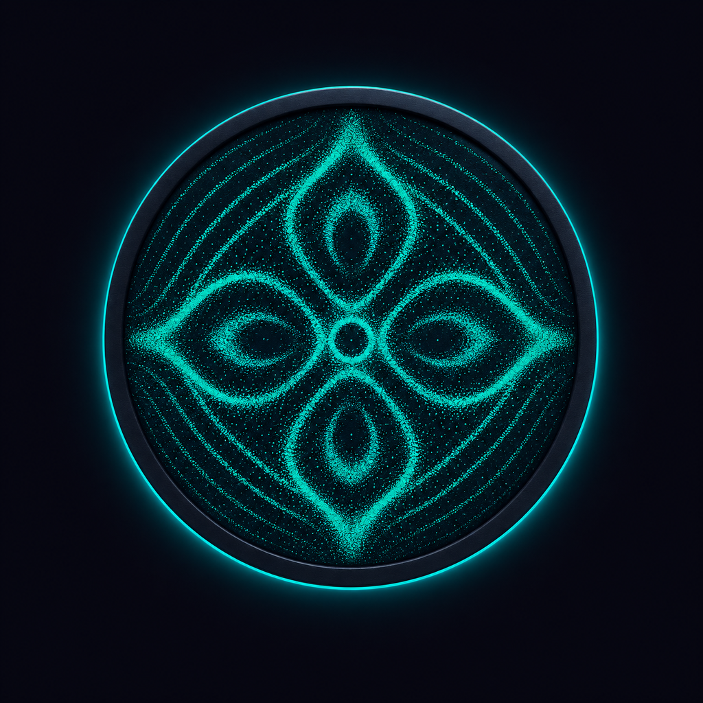
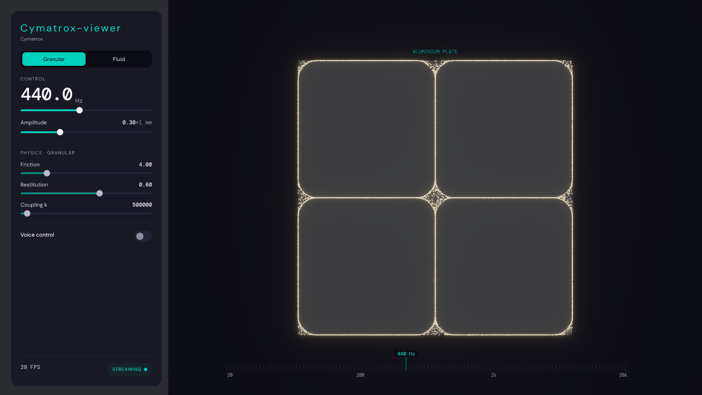
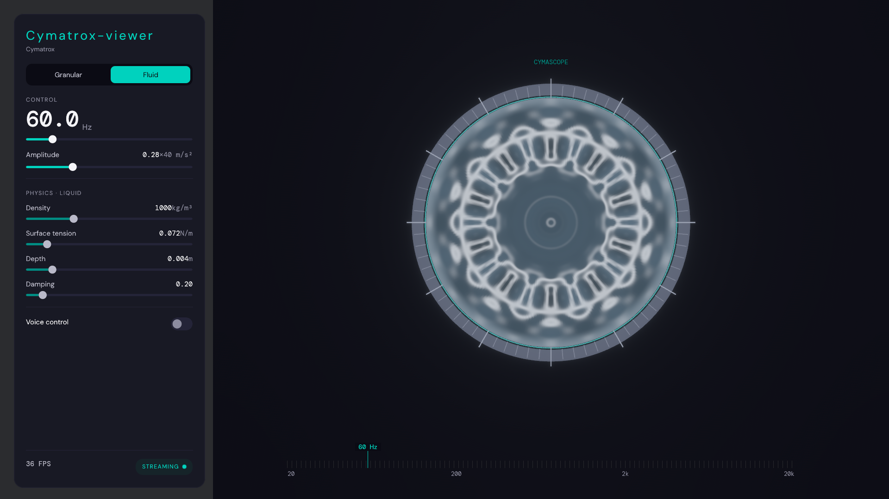

<div align="center">



# Cymatrox Viewer

[](https://github.com/YaogoGerard/cymatrox-viewer/actions/workflows/ci.yml) [](https://github.com/YaogoGerard/cymatrox-viewer#license) [](https://www.rust-lang.org/) [](https://bevyengine.org/) [](https://github.com/YaogoGerard/cymatrox-viewer#installation)

</div>

Interactive cymatics laboratory written in Rust. Visualizes two wave phenomena — granular (Chladni patterns) and fluid (Faraday waves) — with the sand driven by the GPU-accelerated [cymatrox](https://github.com/YaogoGerard/cymatrox) simulation crate and both modules rendered in real-time with [Bevy](https://bevyengine.org/).

## Screenshots

**Granular module** — a live Chladni sand pattern on the illuminated plate, driven from the control panel on the left:



**Fluid module** — the top-down cymascope view of the circular dish, with its graduated instrument bezel and a Faraday mandala:



## Features

- **Two simulation modes**: Granular (Chladni-like patterns), Fluid (Faraday waves on a circular dish).
- **Real-time rendering**: a physically-lit 3D Chladni plate with sand grains and a top-down *cymascope* view of the fluid dish — orthographic, with a graduated instrument bezel and a Faraday mandala shaded as the reflection of a coaxial light ring (the way a real CymaScope photographs a cymaglyph). While a tone is held the surface keeps moving — travelling capillary ripples and a slow slosh — and a tone change grows the new figure in over about a second. Every module runs behind a shared cinematic stack (HDR rendering, filmic Tony McMapface tonemapping and bloom).
- **Interactive control panel**: egui UI to tweak solver/liquid parameters, frequency and driving amplitude.
- **Voice control**: optional microphone FFT input to drive the frequency (pitch).
- **Frame-rate independent pacing**: simulation runs at fixed physics steps per second regardless of render FPS.
- **Production-ready packaging**: deb/AppImage (Linux), NSIS installer (Windows), DMG (macOS, unsigned).
- **Traced logging**: configurable with `RUST_LOG` (e.g. `RUST_LOG=info,cymatrox_viewer=debug`).

## Installation

Download the file for your platform from the [latest release](https://github.com/YaogoGerard/cymatrox-viewer/releases/latest):

| Platform | File | How to install |
| --- | --- | --- |
| Windows (x64) | `cymatrox-viewer_*_x64-setup.exe` | Run the installer. It installs for the current user only — no administrator rights needed. |
| Linux (Debian/Ubuntu) | `cymatrox-viewer_*_amd64.deb` | `sudo apt install ./cymatrox-viewer_*_amd64.deb` |
| Linux (any distribution) | `cymatrox-viewer_*_x86_64.AppImage` | `chmod +x cymatrox-viewer_*_x86_64.AppImage && ./cymatrox-viewer_*_x86_64.AppImage` |
| macOS (Apple Silicon) | `Cymatrox.Viewer_*_aarch64.dmg` | Open the DMG and drag **Cymatrox Viewer** into *Applications*. |
| macOS (Intel) | `Cymatrox.Viewer_*_x64.dmg` | Same as above. |

### Linux, in one command

```bash
curl -fsSL https://github.com/YaogoGerard/cymatrox-viewer/releases/latest/download/install.sh | sh
```

The script picks the right package for your distribution: on Debian and Ubuntu
it installs the `.deb` with `apt` (it then asks for your password); on every
other distribution it installs the AppImage in `~/.local/bin` and adds a menu
entry and the icon, with no root needed. Run it with `--help` to install a
specific version, choose another directory, or uninstall.

Prefer to read it before running it? It is short:

```bash
curl -fsSL https://github.com/YaogoGerard/cymatrox-viewer/releases/latest/download/install.sh -o install.sh
less install.sh
sh install.sh
```

> **macOS:** the builds are unsigned, so Gatekeeper refuses the first launch. Right-click the app and choose **Open** to allow it (or clear the quarantine flag: `xattr -dr com.apple.quarantine /Applications/Cymatrox\ Viewer.app`).

## Documentation

Architecture and design notes live in [`docs/`](./docs/overview.md). They are
meant to be read in order — **Overview → Architecture → Runtime → Data flow →
Simulation → Rendering → UI → Decision records → Glossary** — starting at
[`docs/overview.md`](./docs/overview.md); each page links to the next.

## Contributing

See [CONTRIBUTING.md](./CONTRIBUTING.md) for prerequisites, the check commands CI enforces, and the project layout.

## License

MIT — see [LICENSE](./LICENSE).
