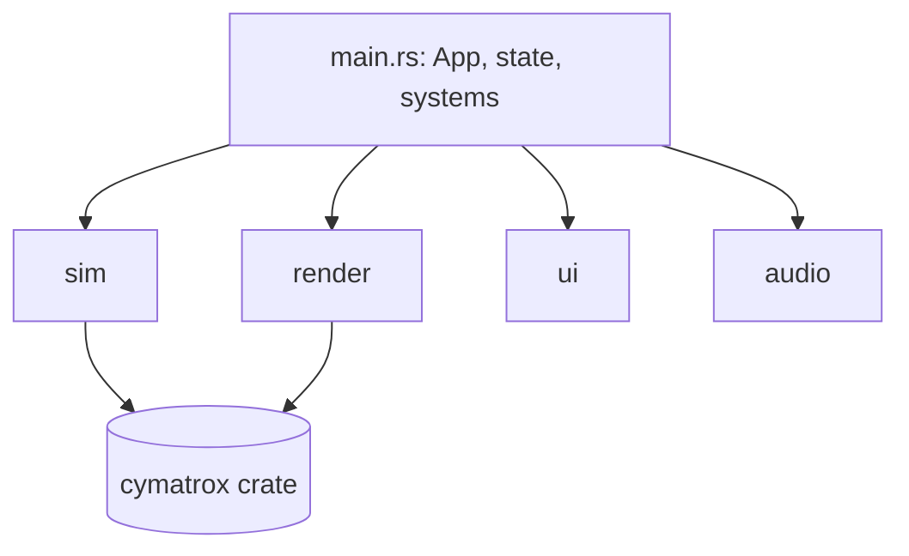

# Architecture

The crate is a single binary (`src/main.rs`) that declares four modules. Shared
application state is defined at the crate root so every module can reach it
through `crate::`.

## Components

| Path | Responsibility |
| --- | --- |
| `src/main.rs` | Crate root: shared state (`UiState`, `ActiveModule`, `SimState`), the module frequency bands, the responsive panel layout, and the Bevy `App` with its systems and wiring. |
| `src/sim/` | The simulation boundary. `mod.rs` owns the sim thread, the parameter slot, the channels and the pacing loop; `granular.rs` and `fluid.rs` hold the physical configs. |
| `src/render/` | Cameras and the three renderers: `camera.rs`, `granular3d.rs`, `fluid3d.rs` and `glyph.rs` (the analytic CymaScope figure). `mod.rs` holds the shared cinematic post-stack and palette. |
| `src/ui/` | The egui control panel: `panel.rs`, `theme.rs`, `widgets.rs` and embedded `fonts/`. |
| `src/audio/` | Optional CPAL microphone capture with FFT pitch detection. |
| `src/bin/gpu_smoke.rs` | A standalone binary that proves the two GPU contexts coexist. |

## Dependency shape

- `sim`, `render`, `ui` and `audio` are siblings; they do not import each
  other's internals. They meet through the shared state at the crate root and
  through the channel resources the sim boundary exposes.
- Only `sim` and `render` touch the `cymatrox` crate: `sim` drives the granular
  solver; `render` uses the crate for the liquid spec and the snapshot type.
- `main.rs` is the only place that knows the whole graph — it wires plugins and
  systems together.

## State owned at the root

| Type | Role |
| --- | --- |
| `UiState` | The single source of truth the control panel reads and writes. Converted to `sim::SimParams` on the way to the solver. |
| `ActiveModule` | Which phenomenon is shown (`Granular` or `Fluid`). |
| `SimState` | The newest snapshot from the sim thread plus any error it reported. |

Keeping these at the root is deliberate: it lets the panel, the renderers and
the sim boundary agree on one definition instead of three.

## Where to make a change

- **New visual for a module** → `src/render/`.
- **New solver parameter** → add it to `SimParams` (and sanitise it), to
  `UiState`, and to the panel; the flow is in [data-flow.md](data-flow.md).
- **New control** → `src/ui/panel.rs`.
- **New module** → add a variant to `ActiveModule`, a band in the root
  `frequency_range`, a renderer, and a branch in the sim thread.

---

[← Previous: Overview](overview.md) · [Next: Runtime model →](runtime.md)
