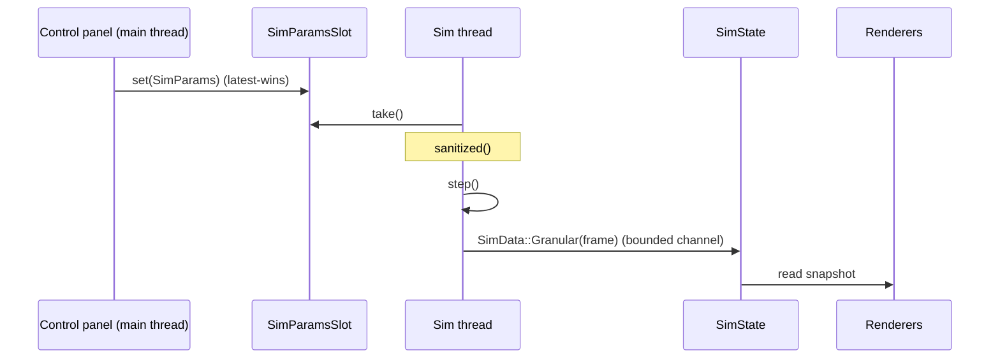

# Data flow

The UI never mutates the simulation directly: it publishes **parameters**, and
the solver publishes **snapshots** back. The two directions use different
mechanisms on purpose.

## Main → sim: latest-wins parameters

`sync_params` copies `UiState` into a `sim::SimParams` and writes it into
`SimParamsSlot` — a single `Arc<Mutex<Option<SimParams>>>`. It is one **slot**,
not a queue: the UI never blocks, and a burst of slider changes collapses to the
most recent value instead of being silently dropped. The sim thread takes the
value each iteration and runs it through `SimParams::sanitized()` before it can
reach the solver.

A separate one-slot channel, `SimControl.switch_tx`, carries module switches.

## Debounced rebuilds

Some parameter changes require rebuilding the solver, which must not happen on
every frame while a slider is dragged:

- `REBUILD_DEBOUNCE = 300 ms` — values must be stable this long.
- `PARAM_EPSILON = 1e-6` — values within tolerance do not count as a change.
- A retune that lands on a different granular mode arms a **rescatter**: the
  plate rim is nodal for every mode, so without it grains pile on the rim and no
  figure forms again. The rebuild waits for the frequency to settle.

## Sim → main: snapshots

The sim thread sends `SimData::Granular(frame)` or `SimData::Status(message)` on
a **bounded** channel (capacity 4). The blocking send doubles as back-pressure:
when the channel is full the sim thread waits, handing the GPU queue back to the
renderer instead of starving it. `poll_sim_data` drains it into `SimState`, which
the renderers read.

## Fluid: the exception

The Fluid module does not go through the sim thread at all. Its CymaScope figure
is the analytic glyph in `render::glyph`, computed synchronously on the main
thread from the current tone and liquid. See
[decisions/0002](decisions/0002-analytic-fluid-figure.md).

## Voice

When voice control is on, `poll_voice` drains `VoiceData { frequency_hz,
amplitude }` from the audio thread, clamps the frequency into the active module's
band, and writes it into `UiState`.

---

[← Previous: Runtime model](runtime.md) · [Next: Simulation domain →](simulation.md)
