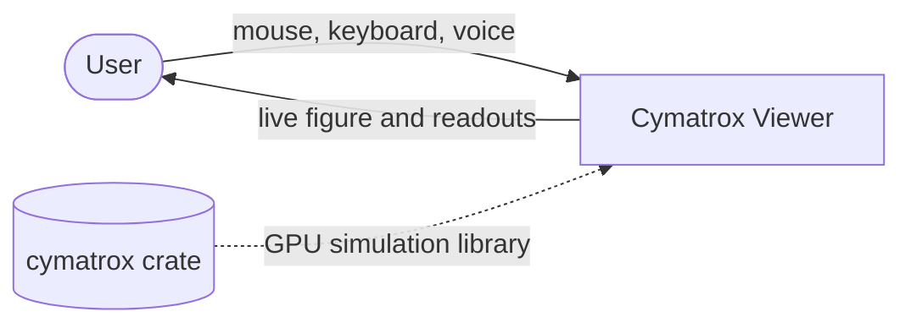
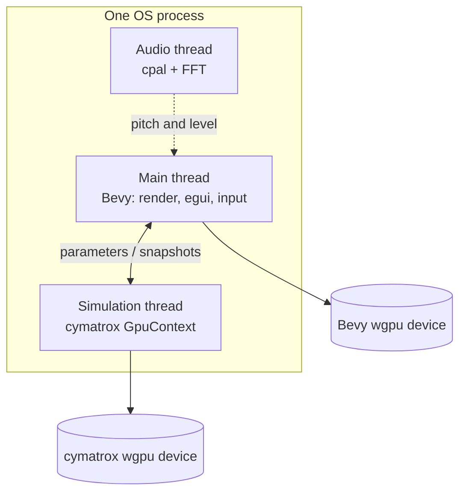

# Overview

Cymatrox Viewer is an interactive **cymatics laboratory**: it visualises, in real
time and in a desktop window, the standing-wave patterns that sound imprints on
a surface.

Two phenomena ship:

- **Granular** — *Chladni patterns*: sand on a driven plate collects along the
  nodal lines of the plate's standing wave.
- **Fluid** — *Faraday waves*: a shallow liquid layer on a circular dish forms a
  stationary figure (a *CymaScope* image) at half the driving frequency.

The user picks a module, sets a tone and physical parameters on a control panel,
and watches the figure respond. An optional microphone input can drive the tone
from the user's voice.

## System context (C4 level 1)

Cymatrox Viewer is a single desktop application. Its only architecturally
significant external dependency is the `cymatrox` crate — a GPU simulation
library. The viewer **uses** it but does not modify it (see
[decisions/0003](decisions/0003-keep-cymatrox-unmodified.md)).

## Containers (C4 level 2)

Inside the process there are three concurrent parts and two GPU devices:

- **Main thread** — the Bevy application: window, cameras, renderers, the egui
  control panel and input. Owns Bevy's wgpu device.
- **Simulation thread** — drives the `cymatrox` solver on its own wgpu
  `GpuContext`, i.e. a **separate GPU device**. It communicates with the main
  thread only through channels and a shared parameter slot.
- **Audio thread** — optionally captures microphone samples and extracts a
  dominant frequency.

The threading and GPU model are detailed in [runtime.md](runtime.md).

## Boundaries and non-goals

- **Viewer-side only.** The `cymatrox` crate is an external dependency; changing
  it is out of scope for this repository.
- The Fluid module's figure is computed analytically in the viewer, not by the
  crate — see [decisions/0002](decisions/0002-analytic-fluid-figure.md).

---

[Back to README](../README.md) · [Next: Architecture →](architecture.md)
