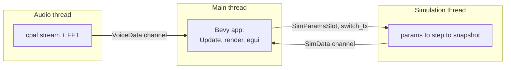

# Runtime model

## Threads

- **Main thread** runs the Bevy `App`. All rendering, egui, input and windowing
  happen here.
- **Simulation thread** (`cymatrox-master`, spawned by `sim::start_sim_thread`)
  builds its own tokio runtime and a `cymatrox::GpuContext`, then loops:
  pull parameters → step the solver → send a snapshot.
- **Audio thread** (`cymatrox-audio`) is started with microphone capture; it
  owns the CPAL stream.

## Two GPU devices

The Bevy renderer and the `cymatrox` solver each create their **own wgpu
device**. They share nothing on the GPU. This is guarded by
`cargo run --bin gpu_smoke`, which brings both up in one headless process and
exits non-zero if either fails. See
[decisions/0001](decisions/0001-two-gpu-contexts.md).

## Frame-rate-independent pacing

The sim thread advances physics at a fixed rate, decoupled from the render FPS,
using an accumulator:

- `GRANULAR_STEPS_PER_SEC = 240` steps/second. Each `step()` integrates a fixed
  `dt = 1/480 s`, so the step rate sets how fast the sand actually flows against
  the wall clock.
- The accumulator grows by `elapsed × steps_per_sec` each iteration and is
  capped at `MAX_BACKLOG_SECONDS = 0.1`. Without the cap a step slower than its
  budget would grow the backlog without bound and spiral; with it, a slow device
  simply self-limits.
- The Fluid module does no solver work (`steps_per_sec = 0`): its figure is
  computed synchronously viewer-side.

## Lifecycle

- **Startup** — `setup_scene` builds cameras and lights; `start_sim` spawns the
  sim thread and inserts the channel resources; `start_audio` starts capture.
- **Module switch** — the UI sends the new module on `SimControl.switch_tx`; the
  sim thread resets its accumulator and timer when it changes.
- **Shutdown** — when the main thread drops the receivers, the sim thread's
  `send` fails and the loop exits (logged as "UI disconnected").

---

[← Previous: Architecture](architecture.md) · [Next: Data flow →](data-flow.md)
